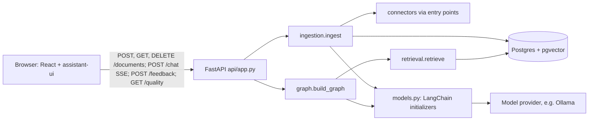

# Architecture overview

Plumbline answers questions over documents you upload, citing where each
answer came from or saying the documents don't cover it. Content enters
through **connectors**, is chunked and embedded into **Postgres +
pgvector**, and is answered by a small **LangGraph** graph that runs inside
the **FastAPI** process. A React + **assistant-ui** chat (the vendored
styled kit on Tailwind, [ADR 0003](../adr/0003-styled-chat-kit.md)) is
served from the same origin. It is a small app shell: a sidebar and one
page at a time, the chat and a Documents page.

Design decisions and their reasons live in
[design.md](https://github.com/AaronProbha18/Plumbline/blob/main/openspec/changes/archive/2026-11-26-rag-foundation/design.md) (D1–D10) and
[docs/adr/](../adr/0001-connector-contract.md). This page is the map; those are the why.

## Where things live

The full tree is in [AGENTS.md](https://github.com/AaronProbha18/Plumbline/blob/main/AGENTS.md#layout). Where new work
goes:

| Adding… | Goes in |
| --- | --- |
| a file connector | its own package, registered under the `plumbline.connectors` entry point ([guide](../guides/connector-development-guide.md)); built-ins in `backend/src/plumbline/connectors/builtin/` |
| an API route | `backend/src/plumbline/api/app.py` (thin: validate, call a module, map errors to status codes) |
| a schema change | a new revision in `backend/migrations/versions/` |
| a UI page or component | `frontend/src/chat/`, `documents/` or `shell/` (navigation and layout), or a new folder per feature; vendored kit parts in `frontend/src/components/` ([guide §4.1](../guides/frontend-development-guide.md#4-components)) |
| the quality summary the UI shows | `backend/src/plumbline/quality.py` (`GET /quality`) |
| answer feedback and its export | `backend/src/plumbline/feedback.py` (`plumbline-feedback-export`) |
| an eval set | `evals/connectors/<name>/{corpus/,golden.yaml}` |

## Flows

### Ingest: `POST /documents`

1. `api/app.py` `upload_document` passes the bytes and filename to
   `ingestion.ingest`.
2. SHA-256 of the bytes. If that hash is already stored, return the
   existing document (**200**, `created: false`), with no other work.
3. Pick the connector by file extension. If none matches:
   `UnsupportedFileType` → **415**, listing supported types.
4. `connector.parse` → sections with locators. If the file is unreadable:
   `ParseError` → **422**.
5. `chunking.chunk` splits each section on its own, so every chunk keeps
   its section's locator.
6. **Embed before writing anything**, so a provider failure stores nothing.
7. Insert the document and all chunks in **one transaction** → **201**.

### Delete: `DELETE /documents/{document_id}`

1. `api/app.py` `remove_document` calls `ingestion.delete_document`: one
   `DELETE` by `public_id`. The chunks go with it through
   `ON DELETE CASCADE`.
2. Deleted → **204**. Unknown or already deleted → **404**
   ("Document not found").
3. Retrieval reads only `chunks`, so a deleted document can't be
   retrieved or cited. Uploading the same bytes again indexes them again
   (**201**).

### Ask: `POST /chat`

1. `api/app.py` `chat` takes the last user message as the question and
   builds the graph with an injected retriever and LLM.
2. `graph.build_graph` runs `retrieve` (`retrieval.retrieve`: exact cosine
   top-k).
3. If there are no chunks, or the best score is below
   `PLUMBLINE_ABSTAIN_THRESHOLD`, it goes to **abstain**, and the LLM is
   not called.
4. Otherwise, **generate**: sources are numbered `[c1]…[cN]`, and the model
   must answer only from them and cite every claim. A reply of
   `NOT_IN_SOURCES`, or one with no valid citation, becomes an
   abstention.
5. The result is recorded as one `answers` row (`feedback.record_answer`).
6. The whole result is computed **before** the response starts (D8,
   option A), then streamed as SSE: `delta…`, `citations`, `done`; or
   `abstain`, `done`; each `done` carries the answer's public `answer_id`.
   If anything fails, including recording, the stream is a single `error`
   with a generic message and no `answer_id`. There is never a confidence
   score.

### Rate an answer: `POST /feedback`

1. The UI shows thumbs up and down on a recorded answer (answers and
   abstentions alike); thumbs down can add a reason and comment.
2. `feedback.save_feedback` upserts the one `feedback` row for that answer,
   so a change replaces the earlier rating: **204**. An unknown `answer_id`
   is **404**, an invalid body **422**.

### Review feedback: `plumbline-feedback-export`

`feedback.export_candidates` turns every feedback row into a candidate in
the `golden.yaml` shape and writes it to `evals/feedback/candidates.yaml`
(git-ignored). A maintainer reviews it and copies entries into a golden set
by hand; nothing is added automatically ([evals README](https://github.com/AaronProbha18/Plumbline/blob/main/evals/README.md#feedback-candidates)).

### Show the last eval: `GET /quality`

1. The route reads the runner's summary file on every request:
   `PLUMBLINE_EVAL_SUMMARY`, default `evals/reports/latest.summary.json`.
   It uses no database and no model.
2. `quality.load_quality` returns `not_measured` (with the eval command) when
   the file is missing or invalid, the run stopped at the judge gate (exit 2)
   or was sampled. Otherwise it returns allowlisted fields only: PASS/FAIL per
   connector as the runner wrote it, the three gated metrics, run date, model
   ids and threshold.
3. `config_matches` compares the evaluated chat model, embedding model and
   abstain threshold with the running ones; the judge is not compared. The
   route always answers **200**.

### Evaluate: `plumbline-eval`

1. `evals.runner.run` checks the judge against human labels first
   (`evals.judge.validate_judge`). If they're unreviewed or agreement is
   below 0.80 → **exit 2**, no result.
2. Per connector: a throwaway database is created and migrated, the corpus
   is ingested with the production `ingestion.ingest`, and every golden
   question is asked through the **production** `graph.build_graph`.
3. `evals.scoring.score_question`, then `aggregate` and `gate`:
   correctness, faithfulness and abstention must each be ≥ 0.80.
4. Write the JSON report → **exit 0** (all pass) or **1**. The database is
   always dropped.

### Open a page: `/app/<page>`

The chat is at `/` and Documents at `/app/documents`. The UI owns routing
(`frontend/src/shell/route.ts`, over the History API), and client pages live
under `/app/` so they cannot collide with an API path. In production,
`api/app.py` serves `index.html` for `GET /app/{path}` when
`PLUMBLINE_UI_DIR` is set, so a reload or a shared page link works; any
other unknown path still gets the API's own 404. No new endpoint carries
data: the Documents page uses the same `/documents` routes as before. The
chat stays in memory while the person moves between pages
([guide §1.4](../guides/frontend-development-guide.md#1-code-organisation)).

## Boundary rules

These are enforced by `backend/tests/test_boundaries.py`, so breaking one
fails CI.

- **The graph knows nothing about HTTP or the database.** `graph.py` gets
  a retriever function and an LLM injected. That's why it is tested with
  fakes and no Postgres.
- **Built-in connectors use only the public contract**
  (`plumbline.connectors.contract`), the same surface a third-party
  connector gets. If a built-in needs more, the contract is missing
  something.
- **Configuration is read in a few places only:** `models.py` (models),
  `db.py` (database location), and the composition roots `api/app.py` and
  `evals/runner.py` (thresholds), plus the migration (vector dimension).
  `config.py` only rejects pre-rename variable names at startup.
  Everything else takes its inputs as arguments.
- **Evals exercise production code**, never a copy of it. A metric that
  moves reflects a real behaviour change.

## Data model and migrations

| Table | Holds | Notes |
| --- | --- | --- |
| `documents` | one row per unique file | `content_hash` (SHA-256) is unique: the idempotency key. `public_id` is `doc_<ULID>`, the only id clients ever see. |
| `chunks` | text + locator + `embedding vector(N)` | `ON DELETE CASCADE` from `documents`; unique `(document_id, ordinal)` |
| `answers` | one row per answer or abstention `/chat` returned | `public_id` is `ans_<ULID>`. Holds the question, answer text, `abstained`, model ids and abstain threshold, and `citations` as JSONB (`document_id`, `title`, `filename`, `locator`) **copied** so a later document delete doesn't lose it. |
| `feedback` | at most one row per answer | `answer_id` is unique; `ON DELETE CASCADE` from `answers`. `rating` up or down, optional `reason` (down only) and `comment` (max 2000), enforced by `CHECK`s. |

**Stored locally:** every question asked and every answer is kept, with no
retention limit, so nobody should type real personal data into the chat.
The exported candidates file holds the same text.

- Internal integer ids never leave the backend.
- `N` comes from `PLUMBLINE_EMBEDDING_DIM` **when the migration runs**,
  and is then fixed. Changing the embedding model means a new migration and
  re-ingesting every document ([ADR 0002](../adr/0002-postgres-pgvector-default-store.md)).
- Schema changes are **new** Alembic revisions with hand-written SQL in
  `backend/migrations/versions/`. Never edit a revision that has been
  applied anywhere.
- Retrieval is an exact scan today. An HNSW index is a later migration,
  added when corpus size makes the scan slow.

`datamodel/` is a separate toolkit: a YAML description of Plumbline's schema that
checks and generates DDL and an explorer
([ADR 0004](../adr/0004-yaml-data-model.md),
[datamodel/README.md](https://github.com/AaronProbha18/Plumbline/blob/main/datamodel/README.md)). Alembic remains the
source of Plumbline's schema; `datamodel/models/plumbline/` mirrors it, and
the `plumbline-drift` CI job fails when the two differ. The toolkit never
reads `backend/` or touches Plumbline's database outside that job.

## Configuration

Every environment variable, with examples, is in the
[README](https://github.com/AaronProbha18/Plumbline/blob/main/README.md#quickstart-docker). Models are chosen as
`provider:model` strings and created through LangChain's provider-agnostic
initializers, so switching provider is a `.env` change plus installing that
provider's package (a `pyproject.toml` extra), never a code change.

## How trust is produced

- **Citations:** an answer is kept only if it cites retrieved chunks. Each
  citation carries the document title and locator, and the UI shows the
  quoted text.
- **Abstention, three ways:** an empty index, a weak best match, or the
  model saying, or implying by not citing, that the sources don't cover
  the question.
- **Measurement:** the eval gates above, per connector, with a judge that
  is itself validated first. Details are in the
  [eval plan](https://github.com/AaronProbha18/Plumbline/blob/main/openspec/changes/archive/2026-11-26-rag-foundation/eval-plan.md).
