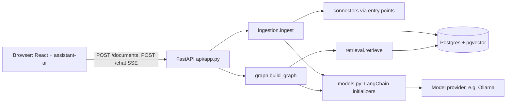

# Architecture overview

insight-rag answers questions over documents you upload, citing where each
answer came from or saying the documents don't cover it. Content enters
through **connectors**, is chunked and embedded into **Postgres +
pgvector**, and is answered by a small **LangGraph** graph that runs inside
the **FastAPI** process. A React + **assistant-ui** chat (the vendored
styled kit on Tailwind, [ADR 0003](../adr/0003-styled-chat-kit.md)) is
served from the same origin.

Design decisions and their reasons live in
[design.md](../../openspec/changes/rag-foundation/design.md) (D1–D10) and
[docs/adr/](../adr/). This page is the map; those are the why.

## Where things live

The full tree is in [AGENTS.md](../../AGENTS.md#layout). Where new work
goes:

| Adding… | Goes in |
| --- | --- |
| a file connector | its own package, registered under the `insight_rag.connectors` entry point ([guide](../guides/connector-development-guide.md)); built-ins in `backend/src/insight_rag/connectors/builtin/` |
| an API route | `backend/src/insight_rag/api/app.py` (thin: validate, call a module, map errors to status codes) |
| a schema change | a new revision in `backend/migrations/versions/` |
| a UI component | `frontend/src/chat/` or `frontend/src/upload/`, or a new folder per feature; vendored kit parts in `frontend/src/components/` ([guide §4.1](../guides/frontend-development-guide.md#4-components)) |
| an eval set | `evals/connectors/<name>/{corpus/,golden.yaml}` |

## Flows

### Ingest: `POST /documents`

1. `api/app.py` `upload_document` passes the bytes and filename to
   `ingestion.ingest`.
2. SHA-256 of the bytes. If that hash is already stored, return the
   existing document (**200**, `created: false`), with no other work.
3. Pick the connector by file extension. If none matches:
   `UnsupportedFileType` → **415**, listing supported types.
4. `connector.parse` → sections with locators. If the file is unreadable:
   `ParseError` → **422**.
5. `chunking.chunk` splits each section on its own, so every chunk keeps
   its section's locator.
6. **Embed before writing anything**, so a provider failure stores nothing.
7. Insert the document and all chunks in **one transaction** → **201**.

### Ask: `POST /chat`

1. `api/app.py` `chat` takes the last user message as the question and
   builds the graph with an injected retriever and LLM.
2. `graph.build_graph` runs `retrieve` (`retrieval.retrieve`: exact cosine
   top-k).
3. If there are no chunks, or the best score is below
   `INSIGHT_RAG_ABSTAIN_THRESHOLD`, it goes to **abstain**, and the LLM is
   not called.
4. Otherwise, **generate**: sources are numbered `[c1]…[cN]`, and the model
   must answer only from them and cite every claim. A reply of
   `NOT_IN_SOURCES`, or one with no valid citation, becomes an
   abstention.
5. The whole result is computed **before** the response starts (D8,
   option A), then streamed as SSE: `delta…`, `citations`, `done`; or
   `abstain`, `done`; or `error` with a generic message. There is never a
   confidence score.

### Evaluate: `insight-rag-eval`

1. `evals.runner.run` checks the judge against human labels first
   (`evals.judge.validate_judge`). If they're unreviewed or agreement is
   below 0.80 → **exit 2**, no result.
2. Per connector: a throwaway database is created and migrated, the corpus
   is ingested with the production `ingestion.ingest`, and every golden
   question is asked through the **production** `graph.build_graph`.
3. `evals.scoring.score_question`, then `aggregate` and `gate`:
   correctness, faithfulness and abstention must each be ≥ 0.80.
4. Write the JSON report → **exit 0** (all pass) or **1**. The database is
   always dropped.

## Boundary rules

These are enforced by `backend/tests/test_boundaries.py`, so breaking one
fails CI.

- **The graph knows nothing about HTTP or the database.** `graph.py` gets
  a retriever function and an LLM injected. That's why it is tested with
  fakes and no Postgres.
- **Built-in connectors use only the public contract**
  (`insight_rag.connectors.contract`), the same surface a third-party
  connector gets. If a built-in needs more, the contract is missing
  something.
- **Configuration is read in a few places only:** `models.py` (models),
  `db.py` (database location), and the composition roots `api/app.py` and
  `evals/runner.py` (thresholds), plus the migration (vector dimension).
  Everything else takes its inputs as arguments.
- **Evals exercise production code**, never a copy of it. A metric that
  moves reflects a real behaviour change.

## Data model and migrations

| Table | Holds | Notes |
| --- | --- | --- |
| `documents` | one row per unique file | `content_hash` (SHA-256) is unique: the idempotency key. `public_id` is `doc_<ULID>`, the only id clients ever see. |
| `chunks` | text + locator + `embedding vector(N)` | `ON DELETE CASCADE` from `documents`; unique `(document_id, ordinal)` |

- Internal integer ids never leave the backend.
- `N` comes from `INSIGHT_RAG_EMBEDDING_DIM` **when the migration runs**,
  and is then fixed. Changing the embedding model means a new migration and
  re-ingesting every document ([ADR 0002](../adr/0002-postgres-pgvector-default-store.md)).
- Schema changes are **new** Alembic revisions with hand-written SQL in
  `backend/migrations/versions/`. Never edit a revision that has been
  applied anywhere.
- Retrieval is an exact scan today. An HNSW index is a later migration,
  added when corpus size makes the scan slow.

`datamodel/` is a separate toolkit: a YAML data model that generates DDL,
migrations and an explorer for **other** schemas
([ADR 0004](../adr/0004-yaml-data-model.md),
[datamodel/README.md](../../datamodel/README.md)). It is not Plumbline's
schema, and it doesn't touch Plumbline's database or Alembic. Whether to
align the two is
[#28](https://github.com/AaronProbha18/Plumbline/issues/28).

## Configuration

Every environment variable, with examples, is in the
[README](../../README.md#quickstart-docker). Models are chosen as
`provider:model` strings and created through LangChain's provider-agnostic
initializers, so switching provider is a `.env` change plus installing that
provider's package (a `pyproject.toml` extra), never a code change.

## How trust is produced

- **Citations:** an answer is kept only if it cites retrieved chunks. Each
  citation carries the document title and locator, and the UI shows the
  quoted text.
- **Abstention, three ways:** an empty index, a weak best match, or the
  model saying, or implying by not citing, that the sources don't cover
  the question.
- **Measurement:** the eval gates above, per connector, with a judge that
  is itself validated first. Details are in the
  [eval plan](../../openspec/changes/rag-foundation/eval-plan.md).
